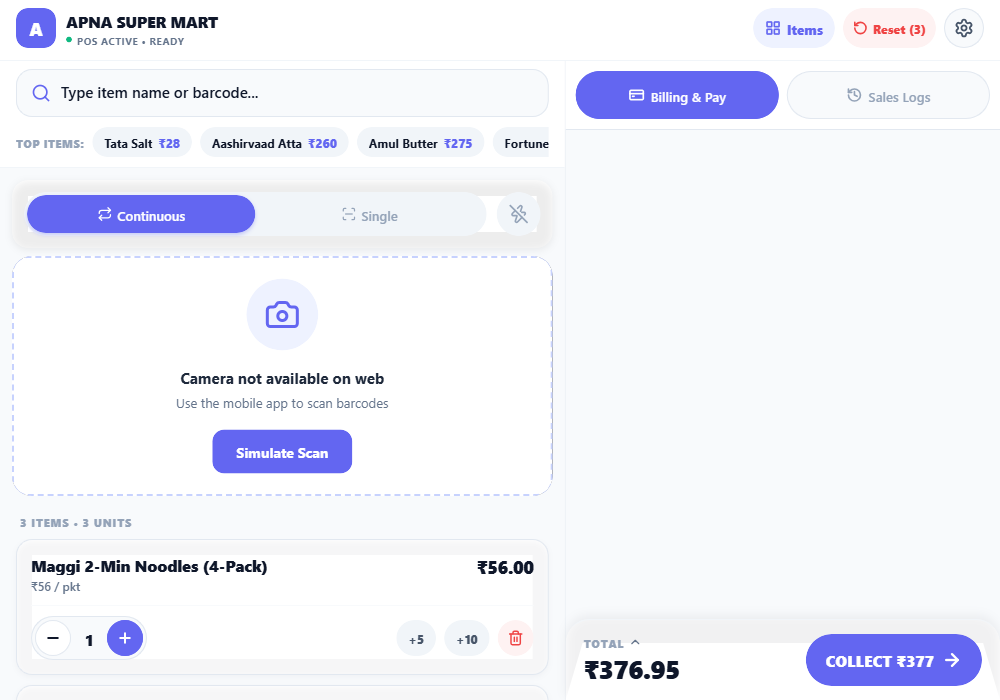

# 🧾 Fast POS — Offline-First Billing & Inventory App


A fast, offline-first **Point of Sale (POS) and billing app** for small shops, built with **React Native**, **Expo SDK 58** and **TypeScript**. Scan barcodes, manage inventory, take cash / UPI / card / Khata payments, and print thermal receipts — all without an internet connection.

---

## 📸 Screenshot



> Captured from the web build in tablet split layout: scanner + cart on the left, billing summary on the right. On a phone the app switches to a bottom-tab UI and the scanner uses the physical camera.

---

## 📚 Table of Contents

- [Features](#-features)
- [Tech Stack](#-tech-stack)
- [Getting Started](#-getting-started)
- [Demo Barcodes](#-demo-barcodes)
- [Project Structure](#-project-structure)
- [Local Data & Persistence](#-local-data--persistence)
- [Build & Ship with EAS](#-build--ship-with-eas)
- [Notes & Limitations](#-notes--limitations)
- [Contributing](#-contributing)
- [License](#-license)

---

## ✨ Features

### 📷 Barcode & QR Scanner
- **Continuous scanning** with a live aiming reticle and target laser line.
- **Two scan modes**
  - *Continuous* — every scan instantly increments or appends the item.
  - *Single* — scans once, shows the item, and pauses until **Scan Again**.
- **Hardware autofocus** — continuous AF by default; tap the preview to force a focus pass, long-press to restart a stuck camera session.
- **Audio + haptic feedback** — crisp 1750 Hz beep (`expo-audio`) and success haptic (`expo-haptics`) on every read.
- **Torch toggle** for dim store rooms.
- **Unknown barcode registration** — the *Not found* banner has an **Add** button that opens the item form pre-filled with the scanned code.

### 🛒 Cart & Billing
- Large `− / qty / +` steppers and one-tap `+1`, `+5`, `+10` shortcuts.
- Live subtotal, discount (flat or %), GST (0 / 5 / 12 / 18 %), and grand total.
- Per-item tax rates pulled from the catalog.
- One-tap item removal.

### 💳 Checkout & Payments
- **Cash** — exact / +₹100 / +₹200 / +₹500 / +₹1,000 / +₹2,000 tendered shortcuts with change-due calculation.
- **UPI QR** — dynamic `upi://pay?pa=...&pn=...&am=...` QR code, compatible with GPay, PhonePe, Paytm, BHIM and Cred.
- **Card** — logs payments taken on an external card terminal.
- **Khata / Credit** — customer ledger entry with name, phone and notes.

### 🧾 Receipts & Printing
- Pixel-perfect **58 mm / 80 mm** thermal receipt HTML via `expo-print`.
- **ESC/POS** command builder (init, bold, double-height, dividers, two-column layout, paper cut) for Bluetooth thermal printers.
- UPI QR printed on the receipt footer.
- **PDF export & sharing** through the system share sheet (`expo-sharing`).

### 📦 Inventory Management
- Add items from the **Products** page, the manual search bar, or a scanner *Not found* banner.
- Full item details: name, barcode/SKU (auto-generated when omitted), price, category, GST rate and unit.
- **Edit & delete** any item; price edits instantly update open cart lines.
- **Search** by name, barcode/SKU or category.
- **Duplicate protection** — SKUs are validated case-insensitively.

### 📊 Sales History & Reports
- Offline invoice log with revenue, bill count and average bill stats.
- Filters: **Today**, **7 days**, **All time**.
- Search by invoice number, customer name or phone.
- One-tap **reprint**, plus **CSV export** and sharing.

### 📱 Responsive Layout
- **Phone** — tabbed UI: *Cart*, *Scan*, *Pay*, *History*.
- **Tablet / landscape** — split pane with scanner + cart on the left and billing + history on the right.

---

## 🧰 Tech Stack

| Area | Technology |
| --- | --- |
| Framework | [Expo SDK 58](https://docs.expo.dev/versions/v58.0.0/) · React Native 0.88 · React 19 |
| Language | TypeScript 6 |
| State | [Zustand 5](https://zustand.docs.pmnd.rs/) |
| Persistence | AsyncStorage |
| Camera | `expo-camera` (`CameraView` + `useCameraPermissions`) |
| Audio / Haptics | `expo-audio`, `expo-haptics` |
| Printing / Sharing | `expo-print`, `expo-sharing`, custom ESC/POS builder |
| QR Codes | `react-native-qrcode-svg` |
| Icons | `lucide-react-native` |

---

## 🚀 Getting Started

### Prerequisites

- **Node.js 20+** and npm
- [Expo Go](https://expo.dev/go) on a physical Android/iOS device, or an emulator/simulator
- A camera-equipped **physical device** to test barcode scanning (web and emulators use a fixed-focus virtual camera)

### Install & run

```bash
git clone https://github.com/sanjayksanthosh/billing-pos.git
cd billing-pos
npm install

# Start the dev server
npx expo start

# Or jump straight to a platform
npx expo start --android
npx expo start --ios      # macOS only
npx expo start --web
```

Scan the QR code from `npx expo start` with Expo Go, or press `a` / `i` / `w` in the terminal.

### Code quality

```bash
npx tsc --noEmit      # typecheck
npx expo lint         # ESLint (expo config)
npx expo-doctor       # dependency & config health check
```

### Adding dependencies

Always install Expo-compatible versions:

```bash
npx expo install <package>
```

Libraries with native code require a **development build** (`npx expo run:android` / `run:ios`, or `eas build --profile development`) — Expo Go only includes its bundled native modules.

---

## 🔖 Demo Barcodes

The catalog ships with 15 pre-loaded products. Type or scan any of these to try the app instantly:

| Barcode | Item | Price | GST |
| --- | --- | ---: | ---: |
| `890103001001` | Tata Salt (1kg) | ₹28.00 | 0% |
| `890103001002` | Aashirvaad Atta (5kg) | ₹260.00 | 0% |
| `890103001003` | Amul Butter (500g) | ₹275.00 | 5% |
| `890103001004` | Fortune Sunlite Oil (1L) | ₹145.00 | 5% |
| `890103001005` | Maggi 2-Min Noodles (4-Pack) | ₹56.00 | 12% |
| `890103001006` | Parle-G Gold Biscuits (100g) | ₹15.00 | 5% |
| `890103001007` | Red Label Tea (500g) | ₹270.00 | 5% |
| `890103001008` | Nescafe Classic Coffee (50g) | ₹195.00 | 18% |
| `890103001009` | Dettol Original Soap (125g) | ₹45.00 | 18% |
| `890103001010` | Surf Excel Quick Wash (1kg) | ₹140.00 | 18% |
| `890103001011` | Farm Fresh Eggs (Pack of 6) | ₹52.00 | 0% |
| `890103001012` | Whole Wheat Bread (400g) | ₹40.00 | 0% |
| `890103001013` | Coca Cola Zero (300ml Can) | ₹40.00 | 18% |
| `890103001014` | Cadbury Dairy Milk Silk (60g) | ₹85.00 | 18% |
| `890103001015` | Colgate Strong Teeth (200g) | ₹115.00 | 18% |

On web, use the **Simulate Scan** button in the scanner panel to test the flow.

---

## 🗂️ Project Structure

```
billing-pos/
├── App.tsx                      # Root component & safe area
├── index.js                     # Expo entry point
├── app.json                     # Expo config, camera permission, plugins
├── eas.json                     # EAS Build profiles
├── eslint.config.js             # ESLint flat config (expo)
├── docs/screenshots/            # README screenshots
├── src/
│   ├── types/index.ts           # Product, CartItem, SaleInvoice, StoreSettings
│   ├── store/posStore.ts        # Zustand store + AsyncStorage persistence
│   ├── data/initialCatalog.ts   # 15 demo products with barcodes
│   ├── utils/
│   │   ├── audio.ts             # Beep + haptics (Web Audio fallback)
│   │   ├── escpos.ts            # ESC/POS command buffer builder
│   │   ├── thermalHtml.ts       # 58/80 mm printable receipt generator
│   │   └── csvExport.ts         # CSV export & share
│   ├── components/
│   │   ├── Header.tsx           # Store identity, cart badge, actions
│   │   ├── ScannerView.tsx      # Camera, reticle, autofocus, scan feedback
│   │   ├── ManualSkuInput.tsx   # Name/barcode search + quick items
│   │   ├── CartList.tsx         # Cart list & empty state
│   │   ├── CartItemRow.tsx      # Row with steppers and bulk adds
│   │   ├── BillSummary.tsx      # Subtotal, discount, tax, grand total
│   │   ├── CheckoutModal.tsx    # Cash / UPI / Card / Khata sheet
│   │   ├── ReceiptModal.tsx     # Receipt preview, print & share
│   │   ├── SalesHistory.tsx     # Invoice log, stats, CSV export
│   │   ├── QuickCatalogModal.tsx# Product grid, search, New/Edit actions
│   │   ├── ProductFormModal.tsx # Shared add/edit/delete item form
│   │   └── StoreSettingsModal.tsx # Store details, GSTIN, UPI, paper width
│   └── screens/
│       └── PosScreen.tsx        # Responsive phone/tablet layout controller
```

---

## 💾 Local Data & Persistence

Everything is stored on-device with AsyncStorage — no backend required:

| Key | Contents |
| --- | --- |
| `@pos_products_v1` | Product catalog (including custom items) |
| `@pos_invoices_v1` | Completed sale invoices |
| `@pos_settings_v1` | Store name, address, GSTIN, phone, UPI VPA, currency, paper width |

The store hydrates on launch and writes through on every mutation, so the app survives restarts and works fully offline.

---

## 📦 Build & Ship with EAS

[EAS](https://docs.expo.dev/eas/) builds, signs and submits the app in the cloud — no local Xcode or Android Studio required.

```bash
# One-time setup
npx eas-cli@latest login
npx eas-cli@latest init

# Development build (custom native modules + dev menu)
npx eas-cli@latest build --profile development --platform android

# Installable preview build
npx eas-cli@latest build --profile preview --platform android

# Store-ready production build
npx eas-cli@latest build --profile production --platform android
npx eas-cli@latest submit --platform android
```

`eas.json` in this repo defines `development`, `preview` and `production` profiles with the `internal` distribution channel for preview builds.

---

## ⚠️ Notes & Limitations

- **Camera on web** — browsers can't run the native barcode scanner; the scanner panel shows a *Simulate Scan* button instead. Use a phone for real scanning.
- **Autofocus** — continues automatically; tap the preview to refocus, long-press to restart the session. Emulators and laptop webcams are fixed-focus and can't autofocus.
- **`ios/` and `android/` are not committed** — they are generated by Expo's Continuous Native Generation. Configure native behavior in `app.json` and config plugins, never by hand.
- **Printing** — thermal printing uses the platform print dialog (`expo-print`) or an ESC/POS Bluetooth bridge; a physical printer is required to test the ESC/POS path.
- **Currency** — defaults to ₹ (INR) and can be changed per store in Settings.
- Default store details (GSTIN, phone, UPI VPA) are **demo values** — replace them in Settings before real use.

---

## 🤝 Contributing

1. Fork the repo and create a feature branch.
2. Use `npx expo install` for any new dependency.
3. Run `npx tsc --noEmit` and `npx expo lint` before opening a PR.
4. Keep the layout responsive for both phone and tablet breakpoints.

Bug reports and feature requests are welcome via [GitHub Issues](https://github.com/sanjayksanthosh/billing-pos/issues).

---

## 📄 License

Released under the [MIT License](LICENSE) © 2026 Sanjay K Santhosh.
